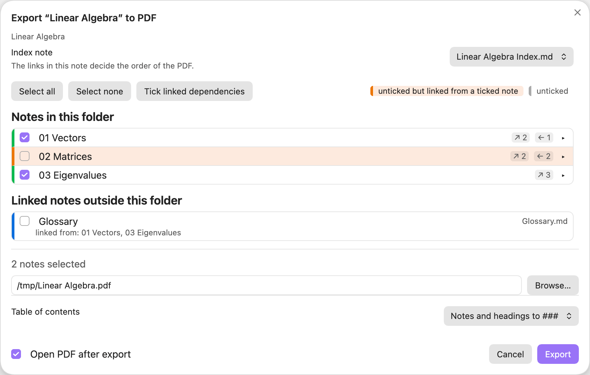
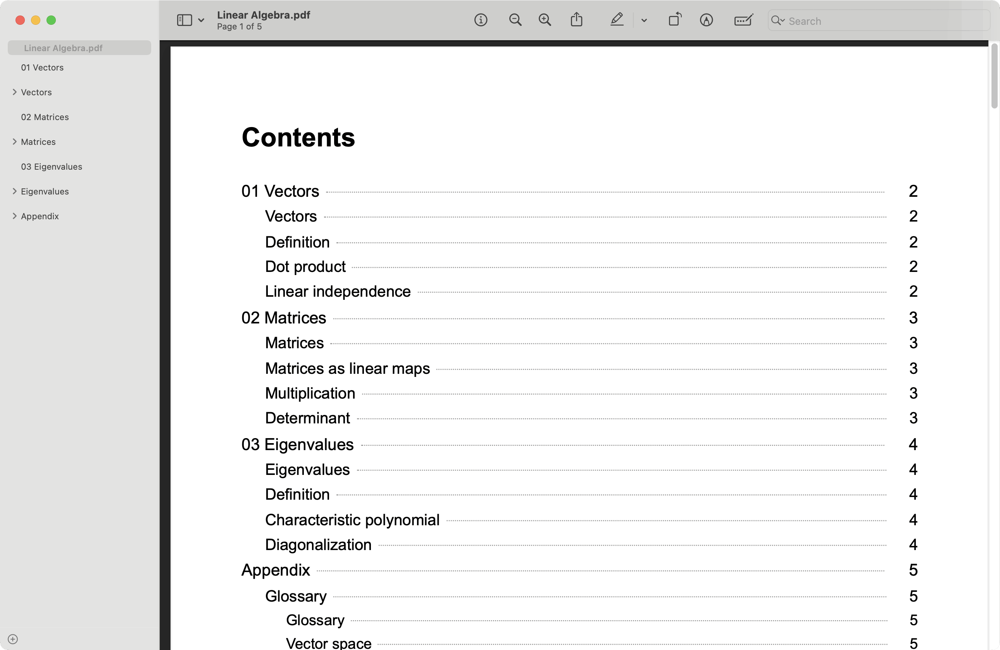

# Folder to PDF

[](https://github.com/dingzy53/obsidian-batch-export/releases/latest)
[](https://community.obsidian.md/plugins/batch-export)
[](https://obsidian.md)
[](LICENSE)

Export all notes in a folder of your [Obsidian](https://obsidian.md) vault to a single PDF.



## Features

- Notes in the order of the folder's index note, with a checklist to leave some out and drag them into a custom order.
- A PDF outline (notes, `##` and `###` headings) and a contents page with page numbers.
- Clickable cross-references between the exported notes.
- Linked notes outside the folder can be added as an appendix.
- Callouts unfolded, and always printed in the light theme.

## Requirements

- Obsidian 1.13.1 or newer, desktop only (the plugin uses Obsidian's own PDF printing).
- Optional: the [Native TikZ](https://github.com/dingzy53/obsidian-tikz) plugin 1.2.0 or newer, so TikZ diagrams print in the light theme. Version 1.2.0 is not released yet. With 1.1.2, diagrams can print in dark colours when Obsidian uses a dark theme.

## Installation

**From the community directory** (recommended)

1. Open **Settings → Community plugins** and turn on community plugins if asked.
2. Select **Browse**, search for **Folder to PDF**, then select **Install** and **Enable**.

You can also open the plugin's page: [community.obsidian.md/plugins/batch-export](https://community.obsidian.md/plugins/batch-export).

**Manually**

1. Download `main.js`, `manifest.json` and `styles.css` from the [latest release](https://github.com/dingzy53/obsidian-batch-export/releases/latest).
2. In **Settings → Community plugins**, select the folder icon next to **Installed plugins**. This opens `<vault>/.obsidian/plugins/`.
3. Create a folder named `batch-export` there and put the three files in it.
4. Select the reload icon next to **Installed plugins**, then enable **Folder to PDF**.

**Beta versions:** install [BRAT](https://github.com/TfTHacker/obsidian42-brat) and add `dingzy53/obsidian-batch-export`.

**Update or remove:** select **Check for updates** or **Uninstall** in **Settings → Community plugins**.

## Usage

- Right-click a folder and choose **Export folder to PDF…**, or run the command for the folder of the active note.
- A checklist starts in index order. Drag the grip handle (or use the arrow buttons) to change the export order; **Reset order** puts it back. Selections, custom order, appendix choices and contents depth are remembered per folder. A note is **amber** when it is unticked but a ticked note links to it, so its cross-references would be dead text.
- Linked notes outside the folder are listed separately and can be added as an **Appendix**.
- The default order comes from the links in the folder's index note.
- Choose the contents-page heading depth in the export dialog. It is remembered per folder.

The PDF has an outline (note, `##`, `###`), a contents page, and clickable cross-references. Output is always light, whatever your Obsidian theme. The plugin only reads your notes and never writes into the vault.



## Settings

Page size, margins, font size, outline depth, contents depth (default for new exports), render timeout.

## Privacy and security

- **Filesystem:** the plugin writes the PDF to the location you choose, using Node's `fs`. It also writes short-lived scratch files to the system temp folder and reads the finished PDF back to compute contents-page numbers and fix link positions. It never writes into your vault.
- **Electron IPC:** the PDF is produced through the `print-to-pdf` IPC call, the same one Obsidian's built-in PDF export uses. `@electron/remote` is used only for the native save dialog and to temporarily switch the window background to white while printing in dark mode.
- **Vault access:** notes are only read (`vault.cachedRead`), never modified.
- **Network:** none.

## Development

```bash
npm install
npm run dev     # watch build
npm run build   # type-check and bundle to main.js
npm run lint
npm test
```

To try a build, symlink `main.js`, `manifest.json` and `styles.css` into `<vault>/.obsidian/plugins/batch-export/`. See [AGENTS.md](AGENTS.md) for design notes.

### Releasing

```bash
npm version patch   # bumps package.json, manifest.json and versions.json, commits and tags
git push --follow-tags
```

The tag triggers the Release workflow, which lints, tests, builds and attaches `main.js`, `manifest.json` and `styles.css` to a GitHub release.

## License

[MIT](LICENSE) © 2026 Ding Zheng Yuan
